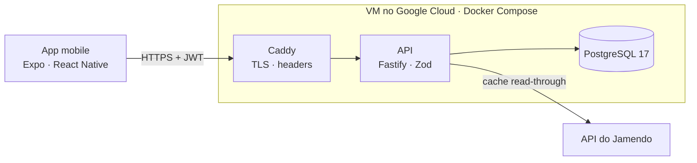

# Sonora

[](https://github.com/JoaoVictorAAbreu-Dev/sonora-music-app/actions/workflows/ci.yml)

Aplicativo de música para iOS e Android que toca faixas com licença **Creative Commons** do
catálogo do [Jamendo](https://www.jamendo.com). O app conversa apenas com uma **API própria**,
que cuida de contas, biblioteca e do acesso ao catálogo.

> **Status:** em desenvolvimento. Ainda não está nas lojas nem publicado em servidor. O código é
> verificado por CI a cada push. Os testes em aparelho real seguem
> [docs/device-testing.md](docs/device-testing.md).

## Para quem vai usar

**O que dá para fazer**

- Criar conta com e-mail e senha e continuar conectado entre aberturas do app.
- Descobrir músicas no **Início** ("Continuar ouvindo", "Feito para você", "Populares").
- **Buscar** por música, artista ou álbum, com buscas recentes e filtros.
- Abrir páginas de **artista** e de **álbum** e tocar tudo com um toque.
- Ouvir com mini player, player em tela cheia, fila editável (arrastar e deslizar para remover),
  modo aleatório, repetição e controles na tela de bloqueio, inclusive em segundo plano.
- Salvar **favoritos**, montar **playlists** e rever o **histórico**.
- Ajustar reprodução contínua, reduzir movimento e reduzir transparência nas **Configurações**.
- **Excluir a conta** a qualquer momento, o que apaga os dados no servidor.

**Acessibilidade**

As telas têm rótulos para VoiceOver e TalkBack e alvos de toque de pelo menos 44 pt. O app respeita
"Reduzir movimento" do sistema ou do próprio app. Com transparência reduzida, o vidro vira uma
superfície sólida.

**Privacidade**

- O app guarda o mínimo: e-mail, nome de exibição, favoritos, playlists e histórico.
- Senhas são guardadas apenas como hash (argon2id). Os tokens de sessão ficam no armazenamento
  seguro do aparelho.
- Não há anúncios nem rastreamento de terceiros.
- A política de privacidade é servida pela API em `/privacy`. O texto atual é um **rascunho** em
  revisão.

**Créditos das músicas**

O áudio e as capas vêm do Jamendo, sob licenças Creative Commons dos próprios artistas. A licença
aparece na página de cada álbum. Nenhuma música ou capa é armazenada neste repositório.

## Para quem vai avaliar o código

### Arquitetura



O app nunca fala direto com o Jamendo. A API valida tudo com Zod, guarda as respostas do catálogo em
cache no PostgreSQL e serve a última cópia válida se o Jamendo cair. O stream é um redirect curto
autenticado.

### Stack

| Camada    | Tecnologias                                                                                                                      |
| --------- | -------------------------------------------------------------------------------------------------------------------------------- |
| Mobile    | Expo SDK 58, React Native 0.88, TypeScript strict, Expo Router, TanStack Query, Zustand, Reanimated 4, react-native-track-player |
| API       | Node 22, Fastify 5, Zod 4, Drizzle ORM, pino, argon2, jose (JWT)                                                                 |
| Dados     | PostgreSQL 17, migrações versionadas com Drizzle                                                                                 |
| Infra     | Docker Compose (Caddy + API + PostgreSQL) em uma VM do Compute Engine, backup com `pg_dump` para Cloud Storage                   |
| Qualidade | Vitest + Testcontainers (API), Jest + React Native Testing Library (app), Maestro (E2E), ESLint, Prettier, GitHub Actions        |
| Design    | Figma como fonte de verdade, com tokens exportados para `packages/tokens`                                                        |

### Destaques técnicos

- **Autenticação:**
  - access token JWT curto (15 min) e refresh token opaco, guardado como hash e **rotacionado** a
    cada uso;
  - reutilizar um refresh token antigo revoga a sessão inteira (detecção de roubo);
  - limite de tentativas por IP, por e-mail e por usuário.
- **Contratos compartilhados:** schemas Zod em `packages/shared` validam a API (entrada e saída) e o
  app (respostas), com um formato único de erro (`{ error: { code, message } }`).
- **Design tokens:** cores, espaçamentos, raios, tipografia e tempos de animação vêm só de
  `packages/tokens`. Um teste falha se o código divergir do snapshot das variáveis do Figma, e o
  ESLint bloqueia cores escritas à mão no app.
- **Player desacoplado:** a fila e as regras ficam numa store testável. O motor nativo fica atrás de
  uma interface, e cada faixa busca um token novo, então sessões longas não expiram no meio da
  música.
- **Biblioteca consistente:** a ordem das playlists é contínua e regravada em transação, e há
  limites por usuário.
- **Acessibilidade testada em CI:** uma auditoria automática verifica nomes acessíveis e alvos de
  toque das telas principais.
- **Logs sem segredos:** senhas, tokens e `Authorization` são omitidos dos logs da API e do Caddy.
  Isso foi verificado enviando um token real e buscando nos logs.

As escolhas e o motivo de cada uma estão em [docs/decisions.md](docs/decisions.md).

### Estrutura do monorepo

```
apps/mobile       App Expo Router (development build; o Expo Go não basta)
apps/api          API Fastify, migrações Drizzle, testes Vitest
packages/shared   Schemas e tipos compartilhados entre API e app
packages/tokens   Design tokens do Figma (única fonte de valores visuais)
infra             Docker Compose, Caddyfile, página de privacidade, backup/restore, healthcheck
docs              Decisões, perguntas em aberto, roadmap e testes em aparelho
.github/workflows CI em cada push e deploy manual
```

## Rodando localmente

**Requisitos:** Node.js 22.12+ (`.nvmrc`), pnpm 10 via Corepack (`corepack enable`), Docker (os
testes da API sobem um PostgreSQL com Testcontainers).

```bash
pnpm install
pnpm run ci          # formatação, lint, typecheck e todos os testes (o mesmo da CI)
```

### API

```bash
docker compose -f infra/docker-compose.dev.yml up -d   # PostgreSQL local em 127.0.0.1:5432
cp apps/api/.env.example apps/api/.env                 # preencha os valores (inclui JAMENDO_CLIENT_ID)
pnpm --filter @sonora/api db:migrate
pnpm --filter @sonora/api dev                          # http://localhost:3000/health
```

Depois de editar `apps/api/src/db/schema.ts`, rode `pnpm --filter @sonora/api db:generate`.

### App

```bash
cp apps/mobile/.env.example apps/mobile/.env           # EXPO_PUBLIC_API_URL
pnpm --filter @sonora/mobile android                   # ou ios: gera um development build
pnpm --filter @sonora/mobile start
```

Para testar no seu próprio celular, incluindo o fluxo do Maestro, veja
[docs/device-testing.md](docs/device-testing.md).

<details>
<summary><strong>Rotas da API</strong></summary>

Todas as rotas `/v1` exceto as de autenticação exigem `Authorization: Bearer <access token>`.

| Método | Caminho                              | Descrição                                                  |
| ------ | ------------------------------------ | ---------------------------------------------------------- |
| GET    | `/health`                            | API e banco no ar                                          |
| POST   | `/v1/auth/register`                  | Cria conta → usuário + tokens                              |
| POST   | `/v1/auth/login`                     | Entra → usuário + tokens                                   |
| POST   | `/v1/auth/refresh`                   | Troca o refresh token (reuso revoga a sessão)              |
| POST   | `/v1/auth/logout`                    | Encerra a sessão                                           |
| GET    | `/v1/me`                             | Usuário atual                                              |
| PATCH  | `/v1/me`                             | Altera o nome de exibição                                  |
| DELETE | `/v1/me`                             | Exclui a conta e todos os dados                            |
| GET    | `/v1/home`                           | Continuar ouvindo, feito para você, populares              |
| GET    | `/v1/search`                         | `q`, `type` (all/tracks/albums/artists), `limit`, `offset` |
| GET    | `/v1/tracks/:id`                     | Faixa                                                      |
| GET    | `/v1/tracks/:id/stream`              | Redirect 302 para o áudio                                  |
| GET    | `/v1/albums/:id`                     | Álbum com faixas                                           |
| GET    | `/v1/artists/:id`                    | Artista com faixas populares e álbuns                      |
| GET    | `/v1/history`                        | Histórico de reprodução                                    |
| POST   | `/v1/history`                        | Registra uma reprodução                                    |
| GET    | `/v1/favorites`, `/v1/favorites/ids` | Favoritos (paginado) e só os ids                           |
| PUT    | `/v1/favorites/:trackId`             | Favorita                                                   |
| DELETE | `/v1/favorites/:trackId`             | Remove dos favoritos                                       |
| GET    | `/v1/playlists`                      | Playlists do usuário                                       |
| POST   | `/v1/playlists`                      | Cria playlist                                              |
| GET    | `/v1/playlists/:id`                  | Playlist com faixas                                        |
| PATCH  | `/v1/playlists/:id`                  | Renomeia ou altera a descrição                             |
| DELETE | `/v1/playlists/:id`                  | Exclui playlist                                            |
| POST   | `/v1/playlists/:id/tracks`           | Adiciona faixa                                             |
| DELETE | `/v1/playlists/:id/tracks/:entryId`  | Remove faixa                                               |
| PUT    | `/v1/playlists/:id/order`            | Reordena faixas                                            |

</details>

## Qualidade

- **CI no GitHub Actions** a cada push e pull request: formatação, lint (zero warnings), typecheck e
  mais de 200 testes automatizados (API contra PostgreSQL real em container, telas do app,
  contratos e tokens).
- **Builds com EAS** (`apps/mobile/eas.json`): perfis `development`, `preview` e `production`.
- **Deploy:** só manual, por `workflow_dispatch` com aprovação. Os detalhes, backup, restore e
  monitoramento estão em [infra/README.md](infra/README.md).

## Documentação

| Documento                                        | Conteúdo                                     |
| ------------------------------------------------ | -------------------------------------------- |
| [docs/roadmap.md](docs/roadmap.md)               | Sprints e issues                             |
| [docs/decisions.md](docs/decisions.md)           | Decisões técnicas e de produto, com o porquê |
| [docs/open-questions.md](docs/open-questions.md) | Pontos que aguardam definição                |
| [docs/device-testing.md](docs/device-testing.md) | Como testar em um celular real               |
| [infra/README.md](infra/README.md)               | Servidor, deploy, backups e monitoramento    |

## Autor

Desenvolvido por **João Victor Alves de Abreu**,
[@JoaoVictorAAbreu-Dev](https://github.com/JoaoVictorAAbreu-Dev).
